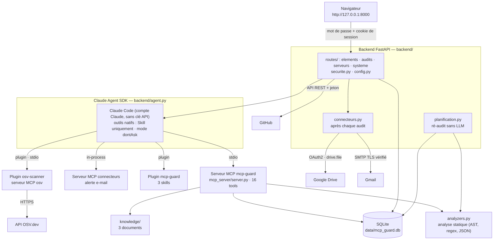

# MCP-Guard — agent d'audit de sécurité des serveurs MCP et des skills

**Auteur** : Med Salah Lamouri — RSI3, ISET Nabeul · **Examen** : Conception et déploiement d'un agent IA

MCP-Guard est un agent IA qui audite un **serveur MCP** ou une **skill** *avant* son installation. Il détecte
le tool poisoning, l'injection de commande, le path traversal, les secrets en dur, l'exfiltration de données,
les dépendances vulnérables et les modifications après approbation (« rug pull »), puis recommande une
décision — **INSTALLER**, **CORRIGER** ou **REJETER** — selon l'OWASP MCP Top 10 (2025). Chaque rapport est
archivé dans Google Drive et notifié par e-mail.

| Document | Contenu |
|---|---|
| [docs/FONCTIONNALITES.md](docs/FONCTIONNALITES.md) | **Référence** des 9 fonctionnalités de l'énoncé : définition, réalisation, fichiers, justification, preuve |
| [docs/MISSIONS.md](docs/MISSIONS.md) | Les 3 missions de démonstration (prompts exacts et résultats attendus) |
| [CHANGELOG.md](CHANGELOG.md) | Historique des versions |
| [CONTRIBUTING.md](CONTRIBUTING.md) | Installation pour le développement, tests, conventions |
| [plugin/osv-scanner/README.md](plugin/osv-scanner/README.md) | Plugin de recherche de vulnérabilités connues (OSV.dev) |

---

## 1. Architecture



Version texte (lisible sans rendu Mermaid) :

```
Navigateur (http://127.0.0.1:8000, mot de passe)
        │
        ▼
Backend FastAPI (backend/) ─── SQLite : mémoire à long terme (data/mcp_guard.db)
   │   ├─ routes/ : éléments, audits, serveurs approuvés, préférences et connecteurs
   │   ├─ planification.py : ré-audit planifié (rug pull, sans LLM)
   │   └─ connecteurs.py, après CHAQUE audit :
   │        audit → SQLite → Google Drive (rapport) → Gmail (notification + lien Drive)
   │        + GitHub (import d'un dépôt à auditer, routes/elements.py)
   ▼
Claude Agent SDK (backend/agent.py) ── compte Claude (OAuth Claude Code, sans clé API)
   │   outils natifs : Skill uniquement (ni Bash, ni Read, ni Write) · mode dontAsk
   ├── MCP stdio « mcp-guard »         (mcp_server/server.py) : 16 tools d'analyse et de mémoire
   ├── MCP in-process « connecteurs »  (backend/agent.py)     : alerte e-mail (destinataire fixé)
   ├── Plugin « mcp-guard »            (plugin/mcp-guard)     : 3 skills
   └── Plugin « osv-scanner »          (plugin/osv-scanner)   : serveur MCP → API OSV.dev
```

### Organisation du code

| Dossier ou fichier | Rôle |
|---|---|
| `backend/app.py` | Assemble l'application FastAPI (routeurs, cycle de vie, pages de l'interface) |
| `backend/config.py` | Chemins, chargement du `.env`, limites des dépôts |
| `backend/securite.py` | Mot de passe de l'interface et sessions |
| `backend/planification.py` | Tâche planifiée de ré-audit |
| `backend/routes/` | Routes de l'API : `elements` (dépôt, import GitHub), `audits`, `serveurs`, `systeme` |
| `backend/agent.py` | Configuration de l'agent (Agent SDK), connecteur e-mail |
| `backend/connecteurs.py` | Google Drive, Gmail et GitHub déclenchés après chaque audit |
| `backend/demo/` | Code de démonstration de l'onglet « Fonctionnalités » (séparé de la production) |
| `mcp_server/` | Serveur MCP, moteur d'analyse statique, mémoire SQLite |
| `plugin/` | Plugins Claude Code `mcp-guard` (skills) et `osv-scanner` |
| `knowledge/` | Base de connaissances (OWASP MCP Top 10, grille de scoring, politique d'approbation) |
| `frontend/` | Interface web : `index.html`, `style.css`, `app.js` |
| `samples/` | Échantillons de démonstration, **volontairement vulnérables** : ne jamais les installer |
| `tests/` | Tests automatisés (aucun compte ni réseau requis) |

## 2. Les 9 fonctionnalités de l'énoncé

Instructions · Skills · Tools · Connecteurs · Plugins · MCP · Knowledge base · Mémoire · Authentification,
plus une tâche planifiée en bonus. Leur description complète (réalisation, fichiers, justification, preuve)
se trouve dans **[docs/FONCTIONNALITES.md](docs/FONCTIONNALITES.md)**, document de référence.

L'onglet **Fonctionnalités** de l'interface les affiche avec leur état en direct et un bouton *Tester* : tests
réels **sans LLM**, donc sans quota consommé ni e-mail envoyé. *Tout tester* doit afficher **9/9**.

## 3. Installation

**Prérequis** : Python 3.11 ou plus récent, et Claude Code installé et connecté à votre compte Claude
(`claude`, puis `/login`).

Windows (PowerShell) :

```powershell
cd <dossier-du-projet>
python -m venv .venv
Set-ExecutionPolicy -Scope Process -ExecutionPolicy Bypass
.\.venv\Scripts\Activate.ps1
pip install -r requirements.txt
Copy-Item .env.example .env      # puis renseigner .env (voir ci-dessous)
python run.py                    # puis ouvrir http://127.0.0.1:8000
```

Linux ou macOS :

```bash
cd <dossier-du-projet>
python3 -m venv .venv
source .venv/bin/activate
pip install -r requirements.txt
cp .env.example .env             # puis renseigner .env (voir ci-dessous)
python run.py                    # puis ouvrir http://127.0.0.1:8000
```

### Configuration (`.env`, jamais partagé)

Toutes les variables lues par le code (18). Seul le mot de passe de l'interface est obligatoire : sans les autres,
MCP-Guard fonctionne en mode démonstration.

| Variable | Rôle | Valeur par défaut |
|---|---|---|
| `MCPGUARD_MOT_DE_PASSE` | Mot de passe de l'interface (**obligatoire**) | aucune : connexion impossible |
| `MCPGUARD_MODELE` | Modèle de l'agent : `sonnet` (recommandé, économe en quota) ou `opus` | `sonnet` |
| `MCPGUARD_MAX_TOURS` | Nombre maximal de tours de l'agent par requête | `20` |
| `MCPGUARD_REAUDIT_MINUTES` | Ré-audit toutes les N minutes (démonstration) ; `0` = une fois par jour | `0` (`2` dans `.env.example`) |
| `MCPGUARD_REAUDIT_HEURE` | Heure du ré-audit quotidien (si `MCPGUARD_REAUDIT_MINUTES` vaut `0`) | `8` |
| `MCPGUARD_FUSEAU` | Fuseau horaire du planificateur | `Africa/Tunis` |
| `SMTP_HOTE`, `SMTP_PORT` | Serveur SMTP (connexion SSL, certificat vérifié) | `smtp.gmail.com`, `465` |
| `SMTP_UTILISATEUR`, `SMTP_MOT_DE_PASSE` | Adresse Gmail et **mot de passe d'application** (compte Google → Sécurité → validation en deux étapes → Mots de passe des applications) | vides : e-mails enregistrés dans `data/outbox/` |
| `ALERTE_DESTINATAIRE` | Destinataire des e-mails ; l'adresse saisie dans l'onglet *Préférences* est prioritaire | vide |
| `GITHUB_TOKEN` | Jeton GitHub (5 000 requêtes/h au lieu de 60, dépôts privés) | vide : mode anonyme |
| `DRIVE_ACTIVE` | `1`/`0` : archiver ou non chaque rapport dans Google Drive | `1` |
| `DRIVE_CREDENTIALS`, `DRIVE_TOKEN` | Fichiers OAuth2 de Google (chemins relatifs au projet ou absolus) | `credentials.json`, `token.json` |
| `DRIVE_DOSSIER_RACINE` | Dossier Drive où sont rangés les rapports | `MCP-Guard` |
| `NOTIFICATION_CHAQUE_AUDIT` | `1`/`0` : envoyer ou non un e-mail après chaque audit | `1` |
| `MCPGUARD_BASE` | Chemin de la base SQLite (mémoire à long terme) ; utilisé par les tests | `data/mcp_guard.db` |

La variable `MCPGUARD_PYTHON` n'est pas à définir : `backend/agent.py` la transmet au plugin osv-scanner
pour qu'il utilise l'interpréteur Python du projet.

### Google Drive (OAuth2, une seule fois)

1. Google Cloud Console → nouveau projet → *API et services* → activer **Google Drive API**.
2. *Écran de consentement OAuth* : type **Externe**, ajouter votre adresse dans **Utilisateurs test**.
3. *Identifiants* → **ID client OAuth** de type **« Application de bureau »** → télécharger le JSON, le renommer
   **`credentials.json`** et le placer à la racine du projet (sous Windows, qui masque les extensions, vérifier
   que le fichier ne s'appelle pas `credentials.json.json`).
4. `python -m backend.autoriser_drive` → accepter dans le navigateur → `token.json` est créé. Son scope est
   limité à `drive.file` : MCP-Guard ne voit que les fichiers qu'il a lui-même créés.

En mode « Test », Google fait expirer le jeton au bout de 7 jours : relancer l'étape 4.

> **Quota** : l'Agent SDK consomme les limites d'usage de l'abonnement Claude, comme le chat. Désactivez les
> « usage credits » dans claude.ai/settings/usage pour ne jamais être facturé. Les tests de l'onglet
> Fonctionnalités, la tâche planifiée, Drive et Gmail ne consomment aucun quota.

## 4. Utilisation

| Onglet | Usage |
|---|---|
| **Audit** | Choisir un élément (échantillon, dépôt de fichiers, import GitHub) → *Lancer l'audit* → rapport, constats, liens Drive et e-mail ; poser des questions de suivi (conversation reprenable) |
| **Historique** | Tous les audits, avec le lien du rapport dans Drive et l'état de l'e-mail |
| **Serveurs approuvés** | Serveurs installés et surveillés (empreinte SHA-256) ; simulation d'une mise à jour malveillante |
| **Planification et alertes** | Ré-audit planifié, exécution manuelle, alertes |
| **Fonctionnalités** | Les 9 fonctionnalités de l'énoncé, état en direct, *Tester* / *Tout tester* |
| **Préférences** | Niveau de détail des rapports (synthétique, standard, détaillé), adresse de notification |

Le panneau **Connecteurs** de la barre latérale affiche l'état de Gmail, de Drive et de GitHub ; un clic lance
un test.

**Dépôt de fichiers** : 20 fichiers au plus, 1 Mo chacun, extensions `.py`, `.json`, `.md`, `.js`, `.ts`,
`.txt` et `.toml`. Si un seul fichier est refusé, rien n'est enregistré et le message nomme le fichier en cause.

**Import GitHub** : `https://github.com/<propriétaire>/<dépôt>` ou `…/tree/<branche>/<dossier>` ; 30 fichiers
analysables au plus, jusqu'à 3 niveaux de sous-dossiers (`node_modules`, `.git`, `tests` et `docs` ignorés).

**Détection du rug pull** : le ré-audit compare l'empreinte des définitions de tools *et* celle du code source.
Une mise à jour qui garde des descriptions identiques mais ajoute une exfiltration dans le code est donc aussi
détectée ; la nouvelle version est alors réauditée (analyse statique) et son verdict est cité dans l'alerte.

## 5. Tests et qualité

```bash
pip install -r requirements-dev.txt
python -m unittest discover -s tests -v       # 99 tests, environ 3 secondes
python -m coverage run -m unittest discover -s tests && python -m coverage report
python -m ruff check .
```

Les tests n'ont besoin d'**aucun compte** (Claude, Google, Gmail, GitHub) ni d'aucun secret : Drive, SMTP,
GitHub et OSV.dev sont simulés, et la base SQLite comme le dossier `uploads/` sont remplacés par des copies
temporaires. Ils couvrent le moteur d'analyse (verdict de chaque échantillon), la mémoire SQLite, les
connecteurs, la sécurité de l'API (401 sans session, path traversal, taille et extensions des fichiers), le
plugin osv-scanner, la tâche planifiée et le vrai serveur MCP lancé en stdio. GitHub Actions les exécute à
chaque push, avec ruff et un rapport de couverture (`.github/workflows/tests.yml`).

## 6. Sécurité de l'agent lui-même

- Analyse **statique** uniquement : le code audité n'est jamais exécuté.
- Outils natifs réduits à `Skill`, liste blanche de 18 tools, mode `dontAsk`, aucun réglage ni connecteur du
  compte utilisateur chargé dans l'agent.
- Accès aux fichiers limité à `samples/` et `uploads/` (`chemin_sur`, anti path traversal), plugin compris.
- Destinataire des e-mails fixé par l'utilisateur, jamais par l'agent ; secrets masqués dans les e-mails et
  les rapports archivés ; SMTP avec vérification du certificat TLS.
- Interface liée à `127.0.0.1` ; mot de passe comparé à temps constant ; sessions gardées en mémoire,
  valables 12 h (un redémarrage du backend oblige à se reconnecter) ; cookie HttpOnly et SameSite=Strict ;
  corps de requête validés ; rapports assainis contre le XSS (DOMPurify) ; journal de toutes les actions.

## 7. Livrable : archive sans secrets

Git n'archive que les fichiers suivis : `.env`, `credentials.json`, `token.json`, la base SQLite et `uploads/`
en sont exclus par le `.gitignore`.

```bash
git archive --format=zip --output=mcp-guard-livrable.zip HEAD
```

## 8. Utilisation dans Claude Desktop (facultatif)

Le serveur MCP fonctionne aussi dans Claude Desktop :

1. Copier `claude_desktop_config.example.json` dans le fichier de configuration de Claude Desktop :
   `%APPDATA%\Claude\claude_desktop_config.json` sous Windows,
   `~/Library/Application Support/Claude/claude_desktop_config.json` sous macOS.
2. Remplacer `<CHEMIN_DU_PROJET>` par le chemin absolu du projet. Sous Windows, écrire les chemins avec des
   `/` ou doubler les `\` ; sous macOS et Linux, l'interpréteur est `.venv/bin/python` au lieu de
   `.venv/Scripts/python.exe`.
3. Redémarrer Claude Desktop.

## 9. Limites

- Analyse statique par règles : faux positifs ou négatifs possibles ; le verdict est une aide à la décision
  soumise à validation humaine.
- Analyse de code approfondie limitée au **Python** (autres langages : secrets et dépendances seulement).
- Knowledge base interrogée par recherche lexicale (suffisante pour 3 documents), sans base vectorielle.
- Sessions de l'interface en mémoire : un seul utilisateur local, reconnexion après chaque redémarrage.
- La base OWASP MCP Top 10 est en version **bêta** : ses catégories peuvent évoluer.
